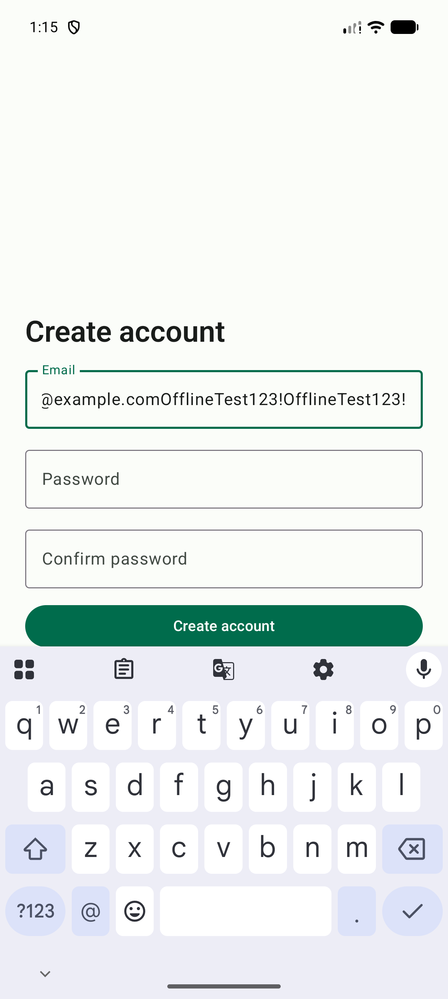
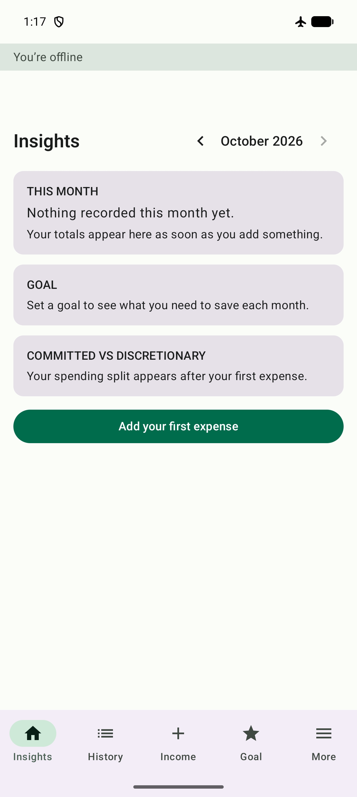
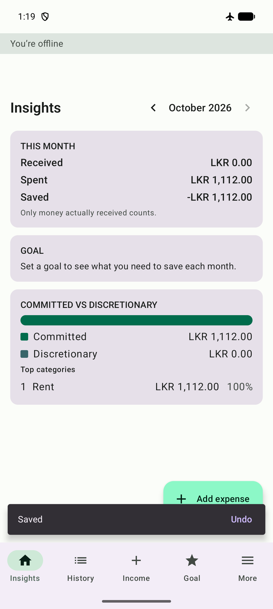
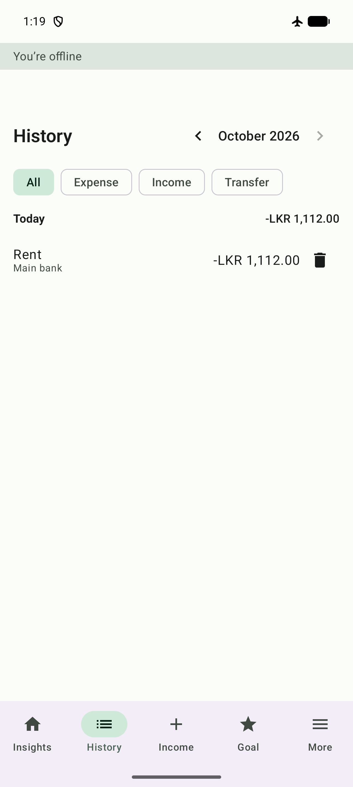
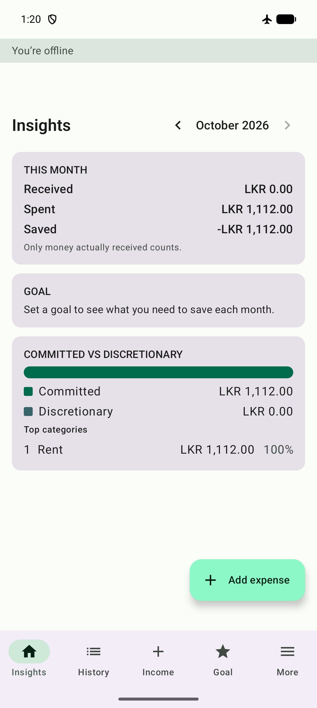
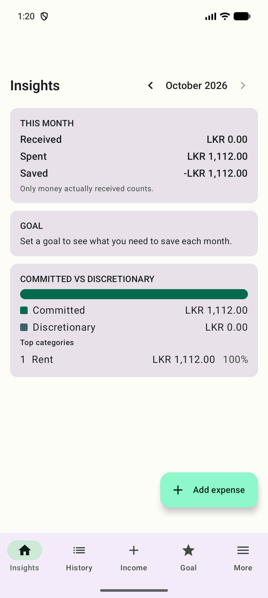
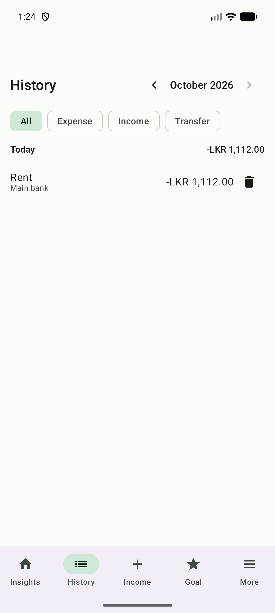

# Offline → online sync verification (#87)

Manual run of the airplane-mode sequence from #87's acceptance criteria, on the Pixel 10 Pro emulator (API 37; #128's full sign-off still needs an API 26 run). Test account: `fundtrail.offline.test@example.com` (created for this run only).

## Steps and evidence

1. **Register a new user.** Sign-up creates the Firebase Auth account and the 4 default accounts / default categories.
   

2. **Airplane mode on.** The "You're offline" banner appears immediately.
   

3. **Add an expense while offline** (Rent, LKR 1,112.00, Main bank). Saved and visible in the Insights dashboard well under 1 second after tapping Save.
   

   It also appears immediately in History:
   

4. **Force-stop the app**, then reopen it **while still offline**. The entry is still there — it was written to Room, not just held in memory.
   

5. **Reconnect.** The offline banner clears.
   

6. **Verify the write reached Firestore.** Rather than extract any credential or token to query Firestore directly, this was verified through the app's own flow: Sign out (clears Room per the M1 logout rule — architecture.md, #51) while online, then sign back in with the same account. Room starts empty again, so anything that reappears had to come from Firestore's `users/{uid}/transactions` collection.

   The Rent entry reappears after the fresh sign-in, confirming the pending write synced to Firestore while offline and was pulled back down cleanly:
   

## Result

All three AC bullets hold:
- `DocumentChange` / Room write-through: the expense is visible in the dashboard and History within 1s of Save, while offline.
- Force-stop + reopen offline: the entry survives, proving it's in Room, not just view state.
- Reconnect: the entry is present in Firestore (`users/{uid}/transactions`), verified via sign-out/sign-in round-trip rather than a direct console/API query.

Test account `fundtrail.offline.test@example.com` and its data are safe to delete; they exist only in the dev Firebase project for this test run.
